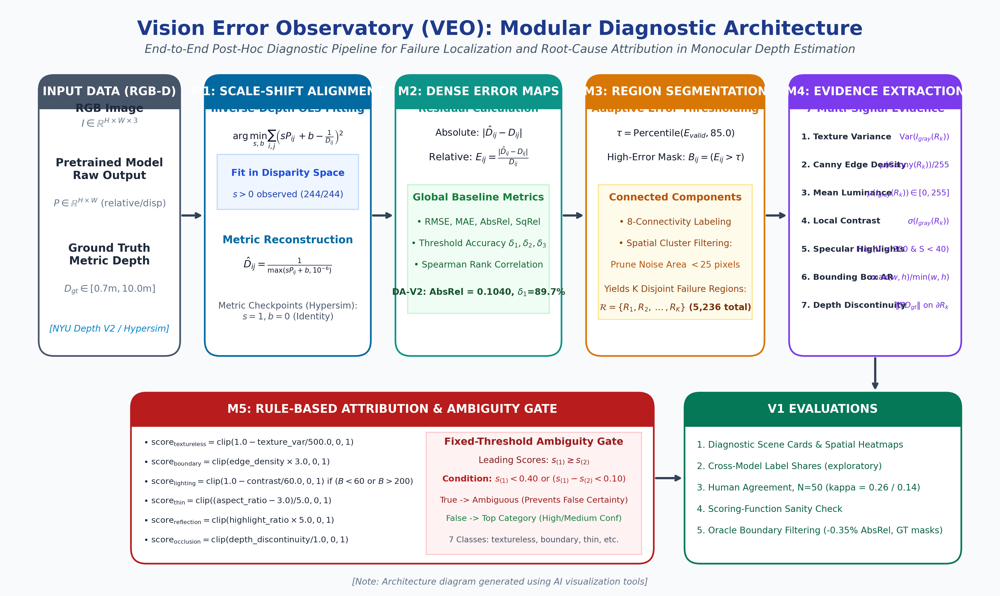

<div align="center">

# Vision Error Observatory (VEO)
### A Model-Agnostic Diagnostic and Observability Framework for Failure Analysis in Monocular Depth Estimation

[](https://www.python.org/)
[](https://pytorch.org/)
[]()
[]()
[](LICENSE)

---

**Anshuman Chakravorty**, **Zeeshan Ali**, and **Omer Faraz**  
*Faculty Mentors:* **Prof. Anshi Bajaj** (Artificial Intelligence) & **Dr. Amit Saini** (Mathematics)  
*School of Technology Management and Engineering (STME), SVKM’s NMIMS University, Hyderabad, India*  
*Contact Email:* `anshumanchakravorty10@gmail.com`

</div>

---

## Overview

Monocular Depth Estimation (MDE) foundation models have reached impressive global benchmark scores, yet standard evaluation protocols rely almost exclusively on dataset-wide scalar summaries (RMSE, MAE, AbsRel, $\delta_1$). These global metrics collapse thousands of 3D spatial predictions into monolithic averages, concealing severe, localized failure clusters (such as reflective glass doors, featureless walls, and slender furniture legs) while offering little insight into the physical or visual mechanisms that triggered the failure.

**Vision Error Observatory (VEO)** is a model-agnostic post-hoc diagnostic framework that aims to move depth evaluation from scalar scoring toward region-level failure attribution. Decoupled from model weights and training gradients, VEO ingests standard prediction arrays, performs inverse-depth scale-shift alignment, isolates high-error regions via connected-components analysis, extracts 7 hand-designed visual evidence features, and assigns each region a failure hypothesis using rule-based scores with a fixed-threshold ambiguity gate (abstains when the top score is < 0.40 or the margin is < 0.10).

> **Status: under revision (v2).** The v1 results below are reported in full, including the unfavourable ones. Several v1 claims were overstated and have been corrected here; the original state is preserved at the git tag `v1-archive`, and every correction is listed in [`docs/ERRATA_V1.md`](docs/ERRATA_V1.md). Known limitations of v1 are listed at the end of the findings.

<div align="center">
  
  <p><em><b>Fig. 1:</b> Modular diagnostic architecture of the Vision Error Observatory (VEO) framework across Modules M1 to M5. [Note: Architecture diagram generated using AI visualization tools].</em></p>
</div>

---

## v1 Empirical Results

All v1 results use 244 NYU Depth V2 images from a custom scene-disjoint test split (1,449 labeled samples partitioned with seed `42`; this is **not** the official NYU 654-image test split, so numbers are not directly comparable with published results). Result files are in [`results/v1/`](results/v1/).

1. **Alignment space (implementation note, not a contribution):**
   * Depth Anything V2 (relative) outputs inverse depth. Fitting it in depth space ($d = s \cdot p + b$) gives a negative scale ($s < 0$) in 244 / 244 test scenes, which is the expected consequence of fitting disparity to depth.
   * Fitting in inverse-depth space ($1/D \approx s \cdot P + b$), the standard practice since MiDaS, gives $s > 0$ in 244 / 244 scenes (observed, not guaranteed) with AbsRel = 0.1040 and $\delta_1$ = 0.8965.
2. **Failure-label distribution across two models (exploratory):**
   * **Depth Anything V2 Small** (5,236 regions): 19.5% `textureless`, 18.0% `boundary_mixing`, 39.3% `ambiguous`.
   * **DPT-Hybrid-MiDaS** (3,689 regions): 17.4% `reflection` vs 13.1% for Depth Anything V2.
   * Caveats: regions are the top 15% of errors *within each image*, so these are shares of each model's relative worst pixels, not absolute vulnerability. No significance test was run. The `reflection` label scored 0/7 against human raters (below), so the reflection difference is not established.
3. **Blinded human agreement (N = 50 test regions, 2 raters):**
   * Inter-rater agreement: Cohen's $\kappa$ = 0.348.
   * **VEO vs. rater 1: $\kappa$ = 0.259, accuracy 36% (18/50), macro-F1 = 0.262. VEO vs. rater 2: $\kappa$ = 0.138.**
   * VEO abstained (`ambiguous`) on 21 / 50 regions. On the 29 regions where it committed to a label, accuracy vs. rater 1 was 58.6% ($\kappa$ = 0.472). The majority-class baseline on that subset is 41.4%.
   * Per-class precision vs. rater 1: `textureless` 7/8, `thin_object` 5/7, `boundary_mixing` 5/7, `reflection` 0/7. VEO never predicted `occlusion` or `poor_lighting`.
4. **Scoring-function sanity check (not a faithfulness result):**
   * Adding noise to the bounding box of `scene_0049` region 8 dropped its `textureless` score from 0.646 to 0.000. Because that score is defined as $1 - \text{variance}/500$, this confirms the implementation behaves as written; it says nothing about the depth model. Tests that re-run the model on edited images are planned for v2.
5. **Oracle boundary-refinement experiment (not deployable):**
   * Bilateral smoothing inside `boundary_mixing` regions across 207 test scenes changed regional RMSE from 0.6629 m to 0.6618 m (−0.16%) and regional AbsRel from 0.2348 to 0.2340 (−0.35%); global RMSE was unchanged (0.4658 m).
   * The pixels to smooth were selected using the **ground-truth** error map, so this cannot run without ground truth. There is no control condition and no significance test.

### Known v1 limitations (being addressed in v2)
* Ground truth is NYU's in-painted `depths`; values in sensor-failure areas (glass, mirrors, dark regions) are filled in, which inflates apparent `reflection` / `poor_lighting` errors.
* Feature thresholds are hand-set, not calibrated against labels. The `occlusion` scale effectively disables that category (22 / 5,236 regions), even though depth discontinuity is the feature most correlated with error (r = 0.45).
* Some features do not isolate their category: `reflection` also fires on bright white walls, and `thin_object` uses bounding-box aspect ratio.
* The human study is small (50 regions, 2 raters) and the raw rating files are not in the repository.

---

## Repository Layout

```text
VEO_V2/
├── configs/                   # YAML configuration profiles
│   ├── nyu.yaml               # NYU Depth V2 protocol & evaluation bounds
│   └── hypersim.yaml          # Synthetic Hypersim metric benchmark config
├── data/                      # Local datasets mount (excluded from git)
│   └── nyu/splits/            # Deterministic scene-disjoint partitions (seed 42)
├── docs/                      # Research documentation & protocol records
│   ├── README.md              # Research documentation index
│   ├── RESEARCH_PROTOCOL_V1.md# Frozen scientific protocol & claim boundaries
│   ├── VEO_PROJECT_SPECIFICATION_LOCAL.md # Pipeline interfaces & contracts
│   ├── VEO_PROJECT_INFO_AND_EVALUATOR_RESPONSE.md # Evaluator audit responses
│   └── notes/                 # Theoretical & mathematical derivation notes
├── figures/                   # 300-DPI publication figures
│   ├── README.md              # Figure index & generation documentation
│   ├── fig1_veo_architecture.png
│   ├── fig2_polarity_and_fingerprints.png
│   └── fig3_intervention_and_downstream.png
├── notebooks/                 # Exploratory inspection notebooks
│   ├── README.md
│   └── VEO_v2_legacy.ipynb    # Prototype development notebook
├── outputs/                   # Empirical evaluation records & JSON artifacts
│   ├── nyu_final/test/        # Depth Anything V2 Small test results (5,236 regions)
│   ├── second_model_dpt_hybrid_midas/test/ # DPT-MiDaS test results (3,689 regions)
│   ├── alignment_ablation_full/ # 244-scene alignment ablation records
│   └── rating_set_test_50/    # Blinded multi-rater human ratings & results
├── results/v1/                # Committed v1 result summaries (JSON/CSV)
├── scripts/                   # Standalone reproduction & evaluation scripts
│   ├── README.md              # Script inventory & execution manual
│   ├── generate_paper_figures.py        # Renders the 300-DPI figures
│   ├── compute_human_agreement.py       # Computes multi-rater Cohen's kappa
│   ├── run_signal_ablation.py           # Feature sensitivity ablation (5,236 regions)
│   ├── run_faithfulness_intervention.py # Scoring-function sanity check (texture noise)
│   └── run_downstream_improvement.py    # Oracle boundary refinement (uses GT errors)
├── src/veo_nyu/               # Core modular Python library
│   ├── cli.py                 # Command-line interface commands
│   ├── config.py              # Configuration parsing & validation
│   ├── inference.py           # Model adapter (Depth Anything V2, DPT)
│   ├── metrics.py             # Scale-shift alignment & dense error maps
│   ├── regions.py             # Connected-components segmentation
│   ├── features.py            # 7 visual evidence feature extractors
│   ├── scoring.py             # Rule-based scores & fixed-threshold ambiguity gate
│   └── validation.py          # Multi-rater Cohen's kappa & ablation metrics
├── tests/                     # Unit test suite (14/14 passing)
│   └── test_core.py           # Test coverage for alignment, metrics, and rules
├── pyproject.toml             # Python packaging & dependencies
├── uv.lock                    # Deterministic dependency lockfile
└── .gitignore                 # Clean repository ignore patterns
```

---

## Quickstart & Environment Setup

This project uses [`uv`](https://github.com/astral-sh/uv) for fast, fully deterministic virtual environment management.

### 1. Installation
```powershell
# Clone the repository
git clone https://github.com/username/VEO_V2.git
cd VEO_V2

# Synchronize dependencies with uv
uv sync --extra dev --extra model
```

### 2. Verify Installation (Unit Tests)
```powershell
uv run pytest -v tests/
# Output: 14 passed in ~12s
```

---

## End-to-End Reproduction Guide

Every empirical result, table, and figure in the paper can be reproduced with a single command:

### 1. Generate Publication Figures (300 DPI)
```powershell
uv run python scripts/generate_paper_figures.py
# Saves Fig 1, Fig 2, and Fig 3 into figures/
```

### 2. Run Feature Signal Sensitivity Ablation (Table VIII)
```powershell
uv run python scripts/run_signal_ablation.py
# Evaluates 5,236 regions across 7 signals, writes outputs/nyu_final/test/signal_ablation.json
```

### 3. Scoring-Function Sanity Check (Fig. 3a)
```powershell
uv run python scripts/run_faithfulness_intervention.py
# Adds noise to scene_0049 region 8 and re-scores it (textureless 0.646 -> 0.000); checks the formula, not the model
```

### 4. Oracle Boundary Refinement (Table IX, Fig. 3b)
```powershell
uv run python scripts/run_downstream_improvement.py
# Bilateral filtering in boundary_mixing regions selected with ground-truth error (oracle); 207 test scenes
```

### 5. Compute Human Agreement (Table VII)
```powershell
uv run python scripts/compute_human_agreement.py --rater1 <rater1.csv> --rater2 <rater2.csv>
# Computes Cohen's kappa, per-class precision/recall/F1 over all 50 regions
# Note: the rater CSVs are not committed yet, and the 29-region subset figure is not computed by this script
```

> Steps 2–5 read from `outputs/` and `data/`, which are not in the repository. A fresh clone cannot run them yet; making every result reproducible from a clean checkout is part of the v2 work.

---

## Citation

If you use the Vision Error Observatory (VEO) software, please cite the repository:

```bibtex
@software{chakravorty2026veo,
  title={Vision Error Observatory (VEO): A Model-Agnostic Diagnostic Framework for Failure Analysis in Monocular Depth Estimation},
  author={Chakravorty, Anshuman and Ali, Zeeshan and Faraz, Omer},
  year={2026},
  url={https://github.com/MdZeeshanAli01/VEO_V2}
}
```

---

## License

This project is licensed under the [MIT License](LICENSE).
